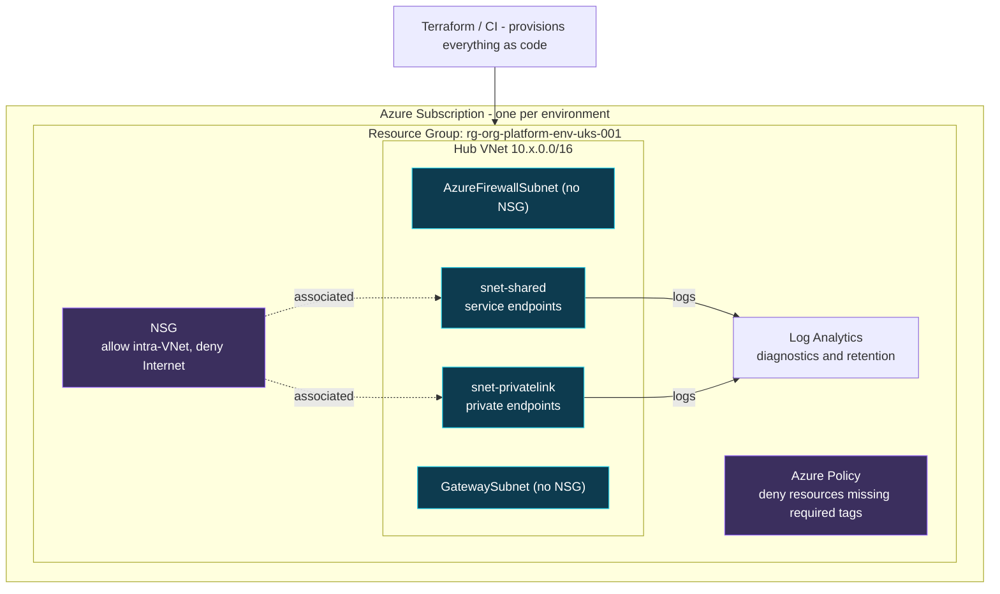
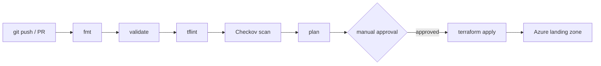
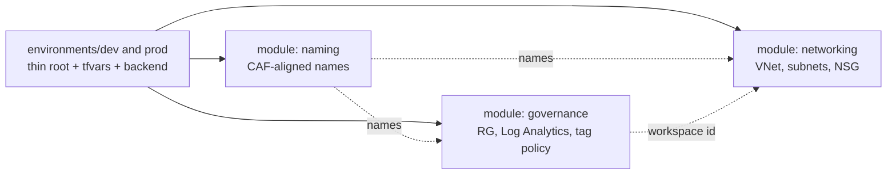

# Azure Landing Zone — Terraform Reference

A production-shaped **Azure hub landing zone**, delivered entirely as code: reusable
Terraform modules, multi-environment composition (dev/prod), governance guardrails,
secure-by-default networking, and CI/CD for both **GitHub Actions** and **Azure DevOps**.

Built to demonstrate how I deliver Azure infrastructure on real engagements —
automation-first, CAF-aligned, and drift-free across environments.

> Reference/portfolio repository. It plans cleanly and is structured exactly as I run
> client estates; storage/state and subscription IDs are placeholders.

---

## Architecture



## Delivery pipeline



## Module composition



---

## What it demonstrates

- **Infrastructure as Code** — Terraform 1.6+, azurerm v4, reusable modules with
  validated inputs, typed `optional()` object variables, and clean outputs.
- **CAF-aligned governance** — standardised resource naming, Log Analytics, and an
  **Azure Policy that denies resources missing mandatory tags** (policy-as-code).
- **Secure-by-default networking** — hub VNet, correctly-named platform subnets
  (Gateway/Firewall excluded from the workload NSG), and an NSG that allows intra-VNet
  traffic while denying inbound Internet. Private Endpoint subnet ready.
- **Multi-environment without drift** — one thin root per environment; only the
  `*.tfvars` and backend key change, so dev and prod are guaranteed the same shape.
- **CI/CD two ways** — GitHub Actions (fmt → validate → tflint → Checkov, matrixed
  per env) and an Azure DevOps multi-stage pipeline (Validate → Plan → Apply with a
  manual approval gate, OIDC auth, remote-state init).
- **No secrets in the repo** — remote state config and cloud auth supplied at runtime.

## Repository layout

```
modules/
  naming/        CAF-aligned, deterministic resource names (one source of truth)
  governance/    resource group, Log Analytics, required-tags Azure Policy
  networking/    hub VNet, subnets, secure-default NSG, NSG diagnostics
environments/
  dev/           thin root: composes the modules + dev tfvars/backend
  prod/          same composition, prod-scaled values
.github/workflows/terraform.yml   GitHub Actions CI
azure-pipelines.yml               Azure DevOps multi-stage pipeline
docs/architecture.md              diagram + design decisions
```

## Usage

```bash
cd environments/dev

# Remote state lives in Azure Storage; values are passed at init (not committed).
terraform init -backend-config=backend.hcl

terraform plan   -var-file=terraform.tfvars
terraform apply  -var-file=terraform.tfvars
```

Promote to production by running the same commands in `environments/prod` — identical
module composition, different scale and state key.

## Tooling

| Area | Tools |
|---|---|
| IaC | Terraform, azurerm v4 |
| Quality | `terraform fmt`, `validate`, tflint |
| Security | Checkov |
| CI/CD | GitHub Actions, Azure DevOps |
| Cloud | Azure — VNet/NSG, Policy, Log Analytics, RBAC-ready |

## About

Built by a Senior Azure Cloud & Security Engineer (Azure Solutions Architect Expert
AZ-305, Terraform Associate) — see [architecture.md](docs/architecture.md) for design
rationale.
