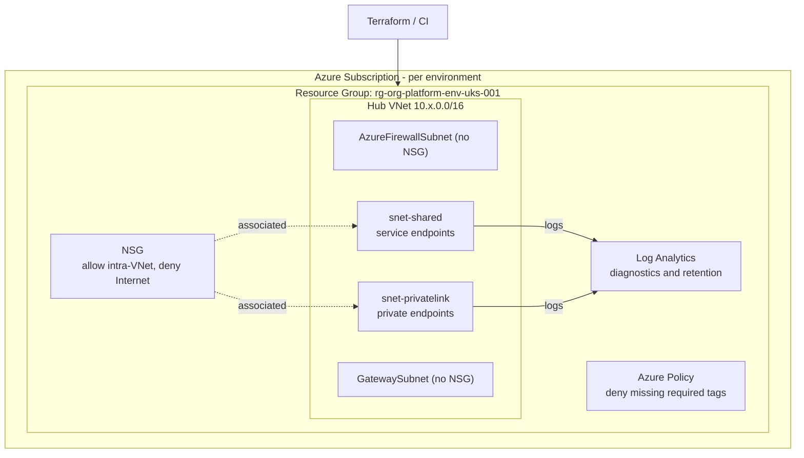

# Architecture

A hub landing zone deployed entirely as code, reused unchanged across environments.

## Design decisions

| Decision | Rationale |
|---|---|
| **Module-per-concern** (naming, governance, networking) | Single responsibility; reusable across workloads and clients. |
| **One thin root per environment** | Identical composition; only `*.tfvars` + backend key differ, so dev and prod can never drift in shape. |
| **Centralised naming module** | Every resource name is deterministic and CAF-aligned — no ad-hoc names, no drift. |
| **NSG deny-Internet by default** | Secure-by-default posture; platform subnets (Gateway/Firewall) correctly excluded from the workload NSG. |
| **Policy-as-code tag enforcement** | Governance guardrail: non-compliant resources are *denied at deploy time*, not flagged after the fact. |
| **Remote state in Azure Storage, config at init** | No state or secrets in the repo; per-environment state isolation. |
| **OIDC / workload identity in CI** | No long-lived cloud credentials stored in the pipeline. |

## Extending

- Add `modules/firewall` and route tables to force tunnelling through Azure Firewall.
- Peer spoke VNets to the hub via a `modules/peering` module.
- Add `modules/private-dns` for Private Endpoint name resolution.
